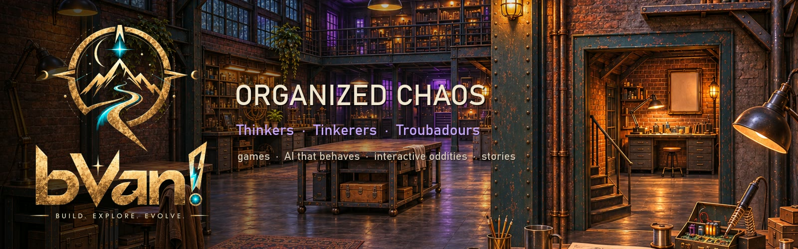
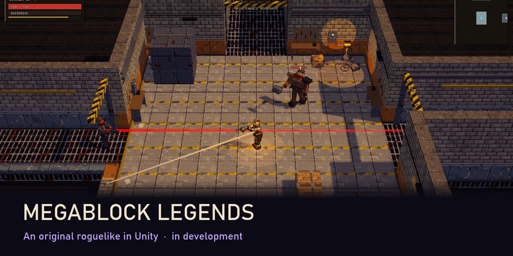
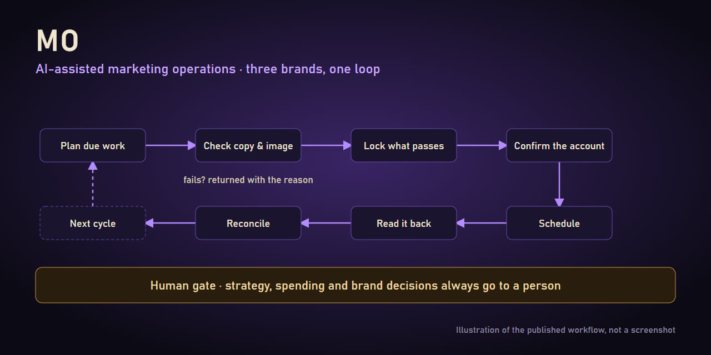
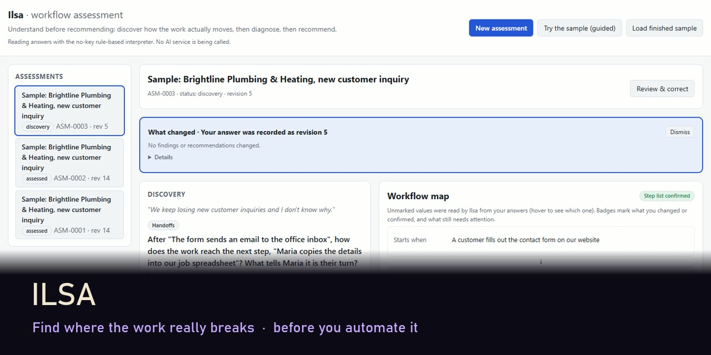
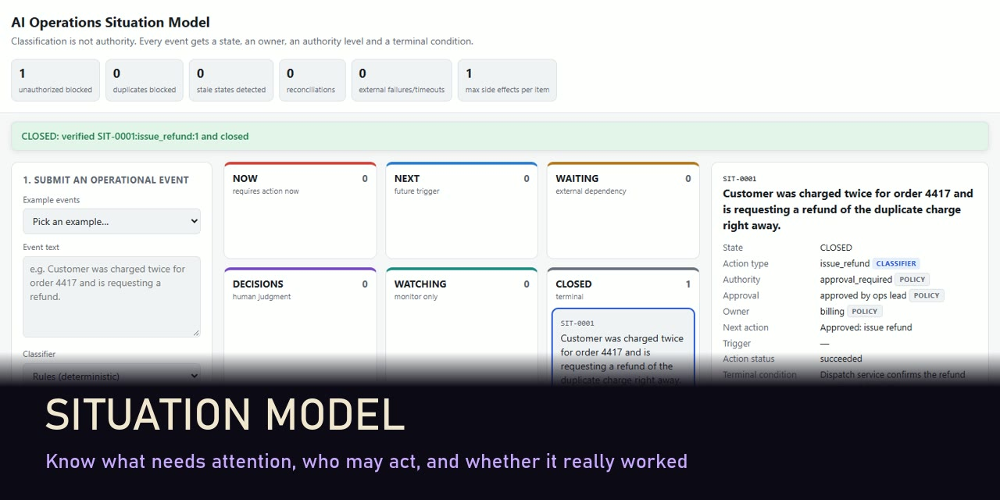
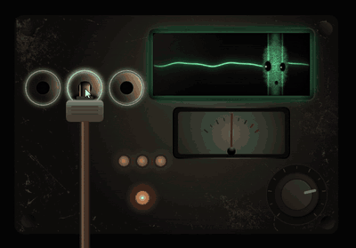
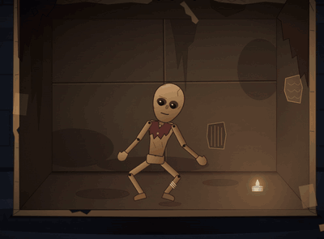
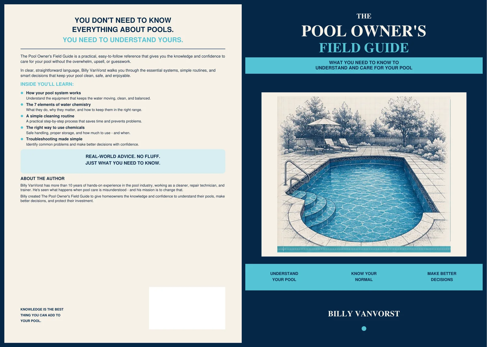

## Hey, I'm Billy.

I build things. Some of them are games, some are AI systems that run real work, and some are odd little interactive machines that exist because I wanted to see if they could.

I'm the person behind **[bVan!](https://bvansystems.com)**, a creative and technical workshop for thinkers, tinkerers and troubadours, and **[Raven Six Creative](https://bvansystems.com/ravensix)**, its creative production arm. Before this I spent twenty-plus years keeping real systems running: Black Hawk maintenance, EMS and firefighting, field service and equipment repair. The habit stuck. Find out what's actually going on, then build the thing that fixes it.

What you'll find here: working demos, a game in progress, and a few experiments. Pull up a stool.

---

## Featured builds

<table>
<tr>
<td width="50%" valign="top">

### [Megablock Legends](https://github.com/bVan566/megablock-legends-showcase)
An original isometric action roguelike I'm building in Unity. Take contracts, descend into the Megablocks, fight, loot, and decide when to cash out. The playable prototype has real-time combat, two archetypes (Gunner and Technomage), a safehouse and character progression.

**Status:** in development · private playtests · not publicly released
</td>
<td width="50%" valign="top">

### [Mo: AI marketing operations](https://github.com/bVan566/mo-marketing-operations-showcase)
Three brands, one marketing loop: plan it, make it, check it, schedule it, and confirm it really went out. Mo runs that loop and keeps evidence of every step. Strategy, spending and brand calls still come to me.

**Status:** in regular internal use · case study (implementation is private)
</td>
</tr>
<tr>
<td width="50%" valign="top">

### [Ilsa: workflow assessment](https://github.com/bVan566/ilsa-workflow-assessment)
"We keep losing customers and I don't know why." Ilsa asks one good question at a time, maps how the work really moves, and only recommends fixes once the process is understood. Every finding points back to the owner's own words.

**Status:** working prototype · [90-second demo](https://youtu.be/ykFrvLkGzrQ) · 108 tests
</td>
<td width="50%" valign="top">

### [Situation Model](https://github.com/bVan566/situation-model-demo)
How does an automated system know what needs attention, what it's allowed to do, and whether the job actually got done? This demo answers all three, and has a Failure Lab where you can try to break it.

**Status:** working demo · [60-second demo](https://youtu.be/GJPaSocJnpc) · 52 tests
</td>
</tr>
</table>

---

## Inside the workshop

Smaller builds, experiments and creative work. Most of these live on [bvansystems.com](https://bvansystems.com/creations).

<table>
<tr>
<td width="50%" valign="top">

**[Séance Switchboard](https://bvansystems.com/seance-switchboard)**: operate a haunted communications machine, and slowly lose control of it. Interactive Rive piece, Halloween challenge entry. [Play it →](https://bvansystems.com/seance-switchboard)
</td>
<td width="50%" valign="top">

**[Haunted Marionette](https://bvansystems.com/haunted-marionette)**: a puppet that learns from you, until it no longer needs the strings. Rive character animation. [Play it →](https://bvansystems.com/haunted-marionette)
</td>
</tr>
<tr>
<td width="50%" valign="top">

**[Media Deck MD-1](https://bvansystems.com/media-deck)**: a retro-futuristic skin for the Video.js player, a hi-fi monitor that powers on with a CRT glow.
</td>
<td width="50%" valign="top">

**[Pool Owner's Field Guide](https://www.amazon.com/dp/B0HHYP413S)**: a published series of practical guides for real pool owners.
</td>
</tr>
</table>

Also on the bench:

- **Poe**: a personal AI partner that keeps context over time and coordinates the specialised agents around it. Private, in development.
- **Market Scout**: a reusable research workflow for jobs, competitions and market opportunities. Internal.
- **[Raven Six films](https://bvansystems.com/ravensix#portfolio)**: short competition films and spec spots, including *The Unfolding* and *The Emberline Archive*.

---

## Under the hood

For the engineers. These write-ups explain the architecture the working demos are built on.

| Repository | What it covers |
| --- | --- |
| [AI Operations Situation Model](https://github.com/bVan566/ai-operations-situation-model) | The state model behind the Situation Model demo: five attention states, authority separate from priority, terminal conditions, reconciliation. |
| [Multi-Agent Operations Architecture](https://github.com/bVan566/multi-agent-operations-architecture) | Specialised AI roles with explicit responsibilities, bounded authority, defined handoffs and human escalation. |
| [Human-in-the-Loop AI Production Pipeline](https://github.com/bVan566/human-in-the-loop-ai-pipeline) | Production with independent QA, purposeful human approval, and verification that a release actually happened. |

The thread running through all of it: **use AI where interpretation or generation adds value, and plain deterministic code where rules, authority and reliability matter more.**

---

## Connect

**[bvansystems.com](https://bvansystems.com)** is the full workshop: every creation, demo and film in one place.
**[Raven Six Creative](https://bvansystems.com/ravensix)** is where the creative production work lives.

*bVan! — Organized Chaos.*
